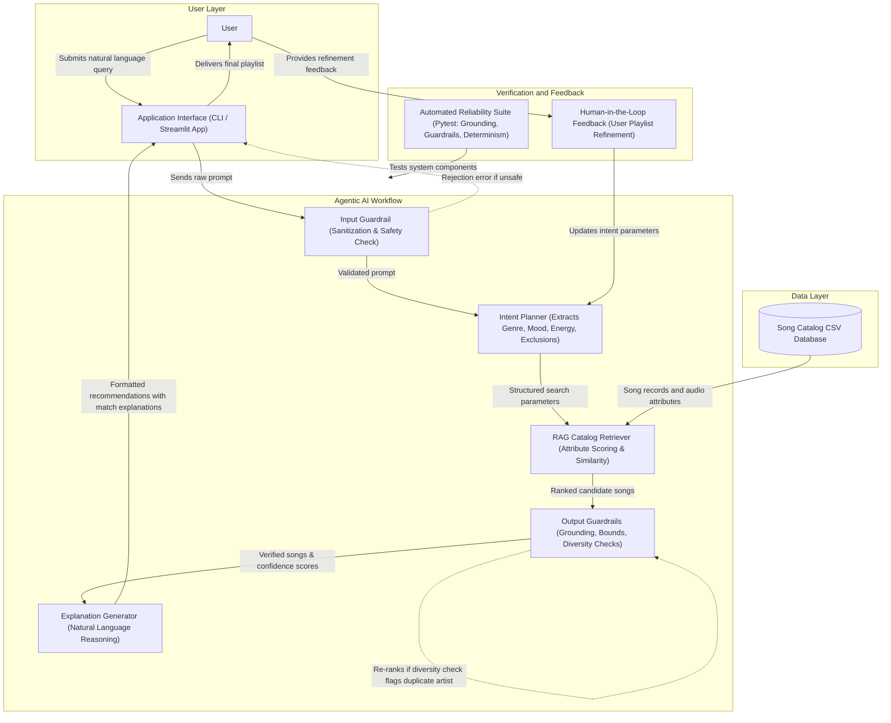

# System Architecture Diagram

This document contains the Mermaid source code for the Applied AI Music Recommender architecture.

## System Workflow Description

1. **User Layer**: The user enters a natural language music preference into either the terminal CLI or the Streamlit web app.
2. **Input Guardrail**: The query is validated for length, completeness, and prompt safety. Unsafe or empty queries are blocked immediately.
3. **Intent Planner**: The agent analyzes the user prompt to identify target genre, mood, target energy, acoustic preference, and excluded genres.
4. **RAG Catalog Retrieval**: The retriever pulls song records from the catalog database and computes similarity scores using audio features (valence, tempo, energy, acousticness) and metadata tags.
5. **Output Guardrails**: The candidates are verified for 100% catalog grounding (no fabricated songs), valid energy ranges, and artist diversity.
6. **Explanation Generator**: The agent builds a natural language explanation describing why the songs were picked and reports overall recommendation confidence.
7. **Human-in-the-Loop Refinement**: If the user wants adjustments (such as higher energy or less acoustic sound), the agent updates the search parameters and re-curates the playlist.
8. **Automated Reliability Suite**: Pytest tests verify that all components operate accurately, deterministically, and safely.
